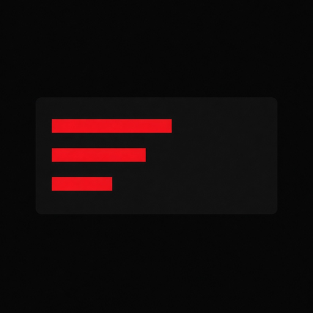

# Global Tier Tagger



**By raincakecat · Version 1.0.0**

A client-side Fabric mod that displays Minecraft PvP tiers from multiple
communities in one place.

## License: All rights reserved

**Do not redistribute, re-upload, or reuse this project's source code, mod
JARs, assets, or modified versions without prior written permission from
raincakecat.** This includes distributing the mod inside a modpack.

You may install and run unmodified official compiled releases for personal
gameplay. This repository is public for inspection; it is not open source.
GitHub's platform permissions to view and fork still apply. Third-party
material retains its own terms. Read [LICENSE](LICENSE) and
[third-party notices](THIRD-PARTY-NOTICES.md) for the full conditions.

## Download and installation

Download the matching JAR from [Releases](https://github.com/raincakecat/global-tier-tagger/releases).
Install Fabric Loader and Fabric API for the same Minecraft version, then
place the mod JAR in your Minecraft `mods` folder. No server installation
is needed. Replace older copies rather than installing multiple versions.

| Minecraft | Java | Minimum Fabric API |
| --- | --- | --- |
| 1.21.11 | 21 | 0.141.4+1.21.11 |
| 26.1.2 | 25 | 0.155.0+26.1.2 |
| 26.2 | 25 | 0.159.0+26.2 |
| 26.3 | 25 | 0.165.2+26.3 |

Fabric Loader 0.20.1 or newer is required by these builds.

## Features

- Up to three tier tags above player names; only the primary appears in tab.
- Shared game-mode selection with optional per-slot advanced overrides.
- Two main game-mode icon sets and fixed specialty icons.
- Full premium-identity player lookup, grouped by tier list or game mode.
- Nearest-player profile lookup, default key **P**.
- Black/red settings with a skin-only rotatable preview and scrollable lists.
- Provider status, community Discord links, and support information.
- Separate RestrictTiers checker with individual and on-demand online scans.

Missing tiers are omitted. Restrictions do not change tags or the tab list.
Provider updates use background requests, caching, deduplication, and backoff;
new rankings can take time to appear and depend on the upstream service.

## Controls

| Control | Action |
| --- | --- |
| **I** | Open settings |
| **P** | Open the nearest loaded player's profile |
| `/tiertagger` | Open settings |
| `/check <username>` | Check restrictions locally |
| `/tiertagger check <username>` | Alternative restriction command |

Keys are rebindable in Minecraft Controls. The first in-world setup defaults
to McTiers and Crystal. Restriction commands and results are local only and
are not sent to server chat.

## Supported tier lists

McTiers, PvP Tiers, SubTiers, Lucnoxity, tiertests.com, MCPVP.com, PvPHQ,
Nova Tiers, Prestige Tiers, Lunar Tiers, Nexus Tiers, JP Tiers, TierMC,
and Crack Tiers.

Only UUID-matched rankings are displayed. PvPHQ requires at least one game
played. Crack Tiers requires its premium account marker. Some communities
have different ranking formats, game modes, and cache schedules.

## Source structure and validation

- `common`: ranking adapters, identity resolution, restrictions, and unit tests.
- `client`: shared UI, settings, commands, keybinds, and assets.
- `client26`: rendering support shared by the 26.x targets.
- `mc12111`, `mc2612`, `mc262`, `mc263`: version-specific Fabric builds.
- `gametest`: synthetic client test fixtures, excluded from production JARs.

The executable code was tested against the three Fabric API versions per
Minecraft target listed in [the compatibility manifest](docs/compatibility-versions.json).
The release has 36 common unit tests and 12 previously completed client/API
combinations. Subsequent 1.0.0 branding and license edits change resources
and metadata only. Those client tests were not rerun for the icon change.

Build entry points (subject to the license; publication of source does not
grant permission to distribute builds or modified versions):

```powershell
# Install JDK 21 and JDK 25; set JAVA_HOME_21_X64 and JAVA_HOME_25_X64.
.\gradlew.bat :common:test releaseJars
.\gradlew.bat :mc12111:runClientGameTest
```

Compiled release files are placed in `build/release/`. For the other client
tests, substitute `mc2612`, `mc262`, or `mc263`. Windows users can run the
full API matrix with Python:

```powershell
python tools/verify-fabric-matrix.py --manifest docs/compatibility-versions.json
```

For 26.3, the Gradle launcher includes Mojang's required
`-XX:StackShadowPages=32` argument. Third-party launchers should retain the
official Minecraft JVM arguments.

## Privacy and service access

The published snapshot contains source, synthetic tests, approved branding,
and build configuration. It excludes private research conversations,
screenshots, runtime player data, credentials, local logs, and build caches.
The mod contacts Minecraft identity services and selected ranking providers
to retrieve profiles. Public API URLs and public Discord invites are included;
no private API key is bundled.

## Support

[Join the support Discord](https://discord.gg/j3QxZ7xYR4).

Global Tier Tagger is independent and is not an official mod of the listed
providers. Please report problems with the Minecraft version, Fabric API
version, mod version, provider name, and error message. Do not publish tokens,
account credentials, or private player data in issue reports.
